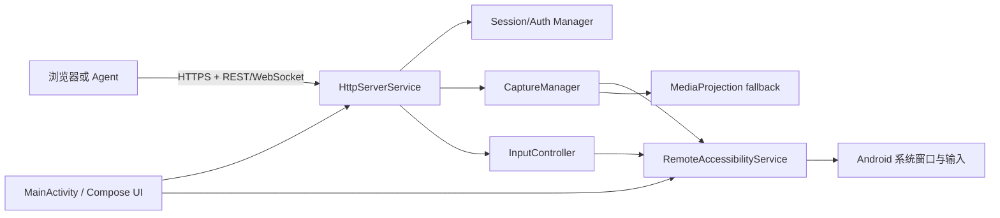

# RemoteApp 安卓被控端设计

跨 Android 版本的后续改造以 [Android 兼容性增强方案](android-compatibility.md) 为准：建议统一使用 MediaProjection 截图、无障碍负责输入。该方案尚未实现；本文下述无障碍截图优先等内容属于早期设计，不代表已完成跨版本验证。

## 1. 产品边界

RemoteApp 安装在一台安卓手机上。手机用户主动开启无障碍服务并启动远程控制后，局域网内的 Agent 或浏览器可以：

- 获取手机当前屏幕截图，或订阅低延迟画面流；
- 发送点按、长按、滑动和系统返回/Home/最近任务等操作；
- 通过手机上显示的配对码建立授权会话；
- 在网页中完成同样的查看和操作。

远程控制必须由手机用户显式开启。应用不会尝试静默启用无障碍服务、绕过系统授权、隐藏前台服务通知或获得 root 权限。第一版只面向可信局域网，公网访问应通过 VPN 或用户自己的反向代理实现。

## 2. 推荐技术栈

- Kotlin、Android Gradle Plugin、Jetpack Compose；
- `minSdk 26`，`target/compileSdk` 使用当前稳定版本；
- AndroidX Lifecycle、DataStore、Security Crypto；
- Ktor Server CIO（HTTP、WebSocket、静态资源）或一个等价的嵌入式 HTTP/WebSocket 服务；
- kotlinx.serialization；
- `AccessibilityService` 负责手势和系统动作；
- Android 11（API 30）及以上优先使用 `AccessibilityService.takeScreenshot`；较低版本或设备兼容性不满足时，使用 `MediaProjection`，由用户在系统弹窗中再次授权。

服务进程不应依赖 Activity 存活。Activity 只负责设置、配对和启停；真正的远程控制由前台服务托管。

## 3. 组件和数据流



建议的包结构：

```text
com.example.remoteapp
  ui/                  # Compose 设置、配对、服务状态
  accessibility/      # RemoteAccessibilityService、节点和手势适配
  capture/             # Accessibility 截图、MediaProjection、帧率控制
  server/              # HTTP 路由、WebSocket、静态网页
  auth/                # 配对、token、撤销、审计
  domain/              # DTO、错误码、设备状态
  platform/            # Android 版本和厂商差异封装
```

截图帧不要在主线程处理。`CaptureManager` 只保留最新帧，采用有界队列（建议长度为 1），编码线程根据订阅者数量决定 JPEG 质量和帧率，避免远程端变慢导致手机内存增长。

## 4. Android 权限与生命周期

Manifest 需要按实际实现声明：

```xml
<uses-permission android:name="android.permission.INTERNET" />
<uses-permission android:name="android.permission.FOREGROUND_SERVICE" />
<!-- 使用 MediaProjection fallback 时（API 34+） -->
<uses-permission android:name="android.permission.FOREGROUND_SERVICE_MEDIA_PROJECTION" />
<!-- Android 13+ 用于显示服务通知 -->
<uses-permission android:name="android.permission.POST_NOTIFICATIONS" />

<service
    android:name=".accessibility.RemoteAccessibilityService"
    android:permission="android.permission.BIND_ACCESSIBILITY_SERVICE"
    android:exported="true">
    <intent-filter>
        <action android:name="android.accessibilityservice.AccessibilityService" />
    </intent-filter>
    <meta-data
        android:name="android.accessibilityservice"
        android:resource="@xml/remote_accessibility_service" />
</service>
```

无障碍配置应声明读取窗口内容、执行手势等能力，并在支持的 API level 上声明截图能力。配置文件中的 `canTakeScreenshot`、`canPerformGestures` 等属性需以当前 compileSdk 的 schema 为准，低版本使用 `res/values-vXX` 或运行时能力检查，避免在旧系统解析失败。

推荐生命周期：

1. 首次打开显示用途、风险和隐私说明；用户跳转系统设置手动启用无障碍服务。
2. 用户点击“启动远程服务”。应用启动前台服务，显示常驻通知和停止按钮。
3. API 30+ 先尝试无障碍截图；失败时在 Activity 中发起 MediaProjection 授权，并把结果交给前台服务。
4. 用户关闭开关、撤销配对、无障碍服务断开或系统回收进程时，立即停止 HTTP 服务并清理投影资源。

无障碍服务断开时，所有输入接口应返回 `503 ACCESSIBILITY_UNAVAILABLE`，而不是排队等待。

## 5. 屏幕捕获和坐标模型

### 捕获优先级

- API 30+：调用 `AccessibilityService.takeScreenshot(displayId, ...)`，将 `HardwareBuffer` 转成 `Bitmap`，再编码为 JPEG/PNG。
- 兼容路径：使用 `MediaProjection` + `VirtualDisplay` + `ImageReader`。必须显示 Android 的用户同意对话框，并按系统版本设置媒体投影前台服务类型。
- `FLAG_SECURE`、DRM 视频、系统权限弹窗等内容可能返回黑屏或不可捕获，这是 Android 的平台限制，接口要允许客户端识别 `CAPTURE_RESTRICTED`。

所有操作使用“物理像素坐标”或“归一化坐标”二选一，不能让客户端猜测缩放比例：

```json
{
  "x": 0.42,
  "y": 0.73,
  "space": "normalized",
  "screenRevision": 1842
}
```

`GET /screen` 通过 `X-Screen-Revision`、`X-Screen-Width`、`X-Screen-Height`、`X-Screen-Rotation` 响应头携带截图对应的几何信息。revision 仅在尺寸或旋转变化时更新，正常画面刷新不会使输入失效。

归一化坐标范围为 `[0, 1]`，以当前截图的可用显示区域为准。服务返回 `width`、`height`、旋转角度、状态栏/导航栏偏移和 `screenRevision`；客户端在发送旧 revision 时得到 `409 SCREEN_CHANGED`，避免旋转或窗口变化后误触。

## 6. HTTP 和 WebSocket API（v1）

所有接口以 `/api/v1` 开头，成功响应为 JSON，错误统一为：

```json
{
  "error": "ACCESSIBILITY_UNAVAILABLE",
  "message": "Accessibility service is not connected",
  "requestId": "..."
}
```

### 设备和状态

| 方法 | 路径 | 用途 |
| --- | --- | --- |
| `GET` | `/api/v1/device` | 设备名、应用版本、Android 版本、屏幕尺寸、旋转角度、服务状态 |
| `GET` | `/api/v1/screen` | 返回当前一张 JPEG/PNG |
| `GET` | `/api/v1/health` | 本地健康检查，不暴露敏感信息 |

### 输入

`POST /api/v1/input/tap`

```json
{"x":0.42,"y":0.73,"space":"normalized","screenRevision":1842}
```

`POST /api/v1/input/swipe`

```json
{
  "from":{"x":0.5,"y":0.8},
  "to":{"x":0.5,"y":0.2},
  "durationMs":450,
  "space":"normalized",
  "screenRevision":1842
}
```

`POST /api/v1/input/long-press` 与 `POST /api/v1/system-action`（`BACK`、`HOME`、`RECENTS`、`NOTIFICATIONS`）可以复用同一套鉴权和 revision 检查。第一版不开放任意 shell、文件系统、短信、通讯录或后台启动 Activity。

### 画面流

`GET /api/v1/stream` 使用 WebSocket。服务端发送：

1. 一条 JSON 元数据：`{type:"hello", width, height, rotation, revision, format:"jpeg"}`；
2. 后续每条二进制消息为一张 JPEG；
3. 客户端发送 `{type:"setQuality", fps:10}` 调整发送频率（1-15 FPS），JPEG 质量固定为 65。

握手升级前校验会话或 API Key。浏览器通过认证的 `POST /api/v1/stream-ticket` 换取有效期 30 秒、单次使用的票据，再以 `ticket` 查询参数连接；票据绑定原凭据。会话撤销、密码修改或 API Key 轮换后，相关旧连接会关闭。

默认上限建议为 10 FPS、720p、JPEG 质量 65。服务端对每个连接限速和限帧，断开时释放订阅。

## 7. 配对、认证与网络暴露

### 密码、配对和 API Key（当前实现）

1. 默认只监听 `127.0.0.1`，用户在应用中打开“允许局域网访问”后才监听局域网地址。
2. 手机用户可设置 6-128 位密码，网页通过 `POST /api/v1/auth/login`（`{"password":"..."}`）取得随机 Bearer 会话。密码使用随机盐和 PBKDF2-HMAC-SHA256（100,000 次）保存于加密偏好设置，在后台线程计算以兼顾旧设备响应；失败登录递增退避 1-32 秒。
3. 启动服务时仍提供 5 分钟有效的六位一次性配对码，兼容 `/api/v1/pairing/claim`。会话 token 只保存 SHA-256 摘要；更新密码撤销已有会话。
4. 手机可生成、复制 256 位随机 API Key。摘要用于验证，原值存于 Android Keystore 保护的 EncryptedSharedPreferences，以便重启后再次复制。Key 不设有效期，重新生成后旧 Key 失效；清数据/卸载同样删除 Key。更改密码、撤销会话及停止服务不删除 Key。
5. `/session/revoke` 撤销当前 Bearer 会话；`/session/revoke-all` 撤销全部会话，两者不轮换 API Key。API Key 只在手机 UI 生成或替换，不通过远程接口读取。

### 传输和访问控制

- 当前实现默认使用 HTTP；手机 UI 必须显式打开局域网访问，并明确提示屏幕和 token 会以明文经过局域网。公网场景不得直接暴露端口。
- 后续切换 HTTPS 时使用安装级证书和配对指纹；在 HTTPS 完成前，VPN 是推荐的跨网络接入方式。
- 除健康检查、登录/配对接口和静态网页外，API 都需要认证。Agent 可使用 `X-API-Key: <key>`、`Authorization: ApiKey <key>` 或 `Authorization: Bearer <key>`；网页使用 Bearer 会话。API 响应禁止缓存。更多来源、请求体大小、并发及输入频率限制仍属于后续硬化工作。
- 可选的 mDNS 服务名为 `_remoteapp._tcp`，只用于发现，不能代替认证。
- 页面和 API 同源提供，避免 CORS 成为默认配置；若 Agent 跨域调用，提供明确的 CORS allowlist。

## 8. 网页控制台

静态网页由同一个 HTTP 服务提供，避免额外部署：

- 左侧显示设备状态、连接质量、截图尺寸和“停止远程服务”；
- 中间显示 `<canvas>` 或 `` 画面，按实际帧尺寸计算归一化坐标；
- 鼠标按下/移动/抬起映射为 tap、swipe、long-press；触摸屏使用 Pointer Events；
- 右侧提供 Back、Home、Recents、刷新截图、画质/FPS 调整；
- 每个危险动作显示当前设备名和连接地址，防止在多个标签页中误控设备。

网页不应在服务器端执行脚本或加载第三方 CDN，减少控制页面被篡改和泄露 token 的机会。token 放在内存或 sessionStorage，提供“撤销当前浏览器”按钮。

## 9. 安全和隐私威胁模型

远程控制等同于把屏幕和输入权限交给网络客户端，必须把“已配对客户端”当成高权限主体：

- 开机或应用重启后默认不自动开放局域网端口，除非用户明确打开持久开关；
- 前台通知显示“正在被远程控制”、客户端 IP 和停止入口；
- 记录配对、连接、输入类型、失败原因和撤销事件，日志中不保存屏幕图片和 token；
- 提供“一键停止服务”“撤销全部 token”“仅本机访问”三个明显操作；
- 认证失败、异常高频手势、连接数超限时临时封禁来源；
- 不把屏幕帧写入磁盘，避免敏感信息残留；
- 在产品文档中明确：用户需要对被控设备和网络拥有授权，不能用于绕过应用安全控制或未经同意监控他人。

## 10. 第一版里程碑

### M0：本地闭环

完成无障碍服务启用引导、单张截图、tap/swipe、前台服务和本机 `127.0.0.1` API。用 Android instrumentation 或手工设备验证旋转、分屏和锁屏行为。

### M1：局域网控制

加入 HTTPS、一次性配对码、token 撤销、`/screen` 和 WebSocket 流，完成手机浏览器以外的一台桌面浏览器控制。

### M2：网页控制台和兼容性

完成静态控制页面、mDNS、MediaProjection fallback、Android 版本矩阵和常见厂商电池优化提示。

### M3：硬化

增加速率限制、审计日志、连接管理、设备旋转/revision 校验、自动化回归测试和可选 VPN/反向代理部署文档。

## 11. 验收标准

- 未启用无障碍服务时，任何输入接口都不能产生系统操作；
- 未配对的客户端只能访问健康检查，不能获得截图或发送输入；
- 手机屏幕旋转后，旧 revision 的坐标请求被拒绝；
- 断开浏览器 WebSocket 后，服务端不会继续生成无订阅帧；
- 点击应用通知中的停止按钮后，端口关闭、投影释放、token 保持可撤销；
- Android 11、13、14 至少各验证一次，覆盖普通窗口、`FLAG_SECURE` 窗口、锁屏和电池优化场景。

