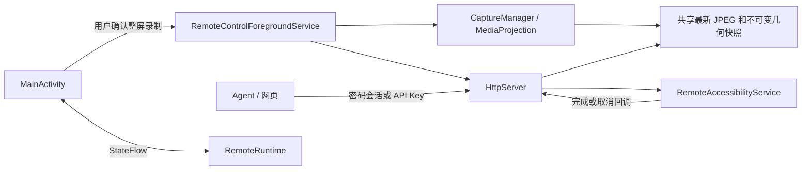

# RemoteApp 安卓被控端架构

## 产品与授权边界

RemoteApp 面向 Android 8（API 26）及以上：手机用户启用无障碍服务、确认系统整屏录制授权并启动服务后，Agent 或浏览器通过 HTTP/WebSocket 查看 JPEG 画面、执行手势和系统动作。默认仅监听 `127.0.0.1:8765`；用户打开 LAN 后监听 `0.0.0.0:8765`。HTTP 仅适用于可信网络或 VPN。

密码和 API Key 长期保留，但捕获授权按会话申请。锁屏/熄屏保留服务；关闭屏幕时不暴露旧画面、不发送盲触摸。若系统撤销录屏授权，连接保留，需手机用户重新同意共享，不重放旧授权。无障碍断开或进程被杀后不静默恢复控制。受保护的窗口可能黑屏；仅提供传输区文件副本收发，不提供解锁、任意 shell、任意路径文件系统或多指事件接口。

兼容性决策及验收清单见 [android-compatibility.md](android-compatibility.md)，已执行结果见 [testing.md](testing.md)。

## 组件与数据流

- `platform/PlatformCapabilities` 集中处理 SDK 差异、整屏授权 Intent 和默认显示器尺寸。
- `RemoteRuntime` 保存运行状态和服务引用；`HostState` 包含 Idle、AwaitingConsent、Starting、Running、Stopping、Error。
- `CaptureManager` 是所有 Android 版本共用的单一截图生产者。
- `RemoteAccessibilityService` 只负责输入和连接状态；不再使用 API 30+ 的无障碍截图路径。
- `HttpServer` 提供认证、截图、画面流、归一化输入及能力状态。具体接口见 [Agent 调用指南](agent-api.md)。

## 启动和停止

1. 可见 Activity 检查无障碍实际连接状态，发起系统捕获授权。API 34+ 使用 `MediaProjectionConfig.createConfigForDefaultDisplay()` 请求整屏。
2. 授权成功后启动前台服务；API 29+ 显式使用 `mediaProjection` 类型，Manifest 声明对应普通权限及 API 34+ 类型权限。
3. 服务进入前台后获取 MediaProjection，先注册生命周期回调，再创建唯一 VirtualDisplay。重复启动不重复消费授权或创建显示器。
4. 有效首帧就绪后才开启 HTTP 监听并发布 Running；首帧超时、无障碍未连接、手机锁定或启动异常时停止服务并显示原因。
5. 用户停止或无障碍断开时，先禁止读取旧画面和提交新输入，再停止监听并释放投影、ImageReader、Bitmap、线程及回调。熄屏时保留监听/投影，仅暂停画面和触摸、清除旧帧并推进revision；亮屏后使用新帧恢复。投影 `onStop()` 时释放捕获资源，保留HTTP监听/会话，等待用户重新授权。

前台服务使用 `START_NOT_STICKY`，不通过开机广播恢复录屏。Activity 重建不重启运行中的捕获；仅保存待授权的 LAN 选择等非敏感界面状态。运行状态通过 StateFlow 更新，错误不会被“服务已启动”的乐观显示覆盖。

已经提交给系统的手势没有通用的撤回 API；停止后禁止新手势，Agent 不应假设先前提交的手势被自动回滚。

## 捕获、性能和屏幕几何

MediaProjection 使用默认内置显示器，VirtualDisplay + RGBA ImageReader + JPEG。捕获缓冲区长边最多 1920 像素，维持整屏比例；这属于内部资源限制，不增加用户分辨率设置。源屏尺寸与 JPEG 尺寸分别记录，不能混用。

一个 HandlerThread 串行处理显示变化和编码，最多每 200ms 编码一次（约 5 FPS）。ImageReader 缓冲上限为 2，Bitmap 和紧凑像素缓冲按几何复用，所有 HTTP/画面流客户端共享最新 JPEG。逐行复制跳过 rowStride padding，包括没有末行 padding 的缓冲区。静止画面可复用最后有效帧；捕获已终止时立即失效，不以旧 JPEG 冒充可用捕获。

几何快照包含源屏宽高、JPEG 宽高、旋转和 revision。API 30+ 查询默认显示器最大 WindowMetrics，旧版本查询 real metrics。API 34+ 同时处理捕获尺寸回调；普通显示变化使用 DisplayListener。旋转或分辨率改变时清空旧帧、替换 Surface 并复用 VirtualDisplay，避免 Android 14+ 重复创建的授权异常。检测到捕获范围与整屏不符时停止控制，不猜测单应用窗口偏移。

坐标为 `[0,1]` 的归一化整屏坐标，乘以源屏尺寸并夹到最后有效像素；不减状态栏或导航栏高度。revision 在映射变化时递增，每次捕获会话使用新的随机安全整数起点，防止进程重启后旧版本再次碰巧有效。手势提交前在主线程再次检查 revision。

## 输入与 Agent 行为

点按、长按和滑动在无障碍主线程执行，等待 `GestureResultCallback`；完成返回 `accepted:true, completed:true`。一个设备同一时刻只接受一个屏幕手势，忙时返回 `409 INPUT_BUSY`，取消返回 `409 GESTURE_CANCELLED`。请求断开不会提前释放手势门闩。若系统超时未确认完成，停止控制，要求用户重新启动，防止未知状态下继续输入。

系统动作仍返回 `accepted:true`，仅表示 Android 接受动作，不保证目标界面已绘制完成。Agent 在每次操作后应重新截图确认。旧 revision 返回 `409 SCREEN_CHANGED`，必须重新观察目标，不能自动重放原坐标。

`/device` 暴露实际捕获状态、是否可控制、源屏/JPEG 尺寸、默认显示器 ID 和帧序号。截图头包含同一帧的版本、几何和帧年龄；帧年龄是诊断数据，静止画面年龄较大不等于会话失效。

## 网页与画面流

WebSocket 升级前校验认证，最多同时 4 路画面流；慢连接发送有超时。默认发送上限为 5 FPS，客户端可请求 1–15 FPS，但底层编码仍最多约 5 FPS，不保证更高的有效更新率。

首条 `hello` 描述几何，几何变化后再次发送 hello。每个 JPEG 前发送 `type:frame` 元数据，包含该二进制 JPEG 的 revision、尺寸、源屏尺寸和 sequence。网页只保留最新待解码帧，绘制完成后才更新可点击版本；异步旧帧、旧连接和过期 HTTP 响应不能覆盖新会话。断线、页面隐藏和离线期间禁止画布输入，恢复后重新获取画面和流票据。

App 设置页可滚动、避让安全区和键盘，Key 按钮允许换行；运行时显示本机或 LAN 地址。网页维持画布比例和至少 44px 操作目标，兼顾手机横竖屏和桌面窗口。

## 认证与持久化

手机设置的 6–128 位密码通过随机盐 + PBKDF2-HMAC-SHA256（100,000 次）验证，在后台线程计算；密码与配对码分别使用手机级（非IP级）持久化限速：前4次失败分别等待1/2/4/8秒，第5次失败冻结300秒；前4次失败后静默15分钟或认证成功清零，5分钟冻结结束后重新计数。冻结期间不校验凭据、不增加计数、不延长期限，服务/进程重启不清零；更换IP、伪造代理头或手机生成新配对码不能绕过。失败状态写入加密偏好，写入失败不发放会话。本地成功设置新密码可清除密码限速；配对码限速独立保留。手机级限速可能暂时影响其他新登录者，已有会话与API Key仍可使用。首次错误返回401，第5次错误及冷却期间返回429 AUTH_RATE_LIMITED；响应Retry-After与JSON retryAfterSeconds指示等待秒数，网页倒计时禁用对应按钮，刷新网页不能绕过服务端限制。旧密码格式在成功登录时升级。一次性配对码继续支持，5 分钟有效。

手机生成 256 位随机永久 API Key，支持 `X-API-Key`、`Authorization: ApiKey` 和 Bearer；随机会话使用 Bearer。Key 原值和验证摘要保存在 Android Keystore 保护的 EncryptedSharedPreferences，允许重启后再次复制。更新密码撤销会话；撤销会话、停止服务和重新录屏不轮换 Key。手机重新生成 Key 会使旧 Key 及相关流凭据失效。卸载或清除数据会删除凭据。

浏览器先通过认证接口获取 30 秒单次流票据，避免将永久 Key 或会话 token 放入 URL。流持续检查原凭据；撤销后关闭连接。API 响应禁止缓存。日志和仓库不保存密码、Key、token 或屏幕内容。

## 已知边界

厂商可能回收进程或禁用无障碍，设置页提供排查说明，但不承诺后台永久在线。没有完成验收的折叠屏、外接屏、多显示器和厂商浏览器不声明支持。模拟器验证系统 API，不能替代厂商设备上的电池策略、性能、锁屏和输入行为测试。

## 剪贴板访问

`GET/POST /api/v1/clipboard` 复用现有认证，仅显式读取/写入文本，最大 65536 UTF-16 单元。访问 Android ClipboardManager 在主线程进行，不持久化、不缓存、不记录内容，不主动轮询。Android 10+ 读取前检查 MainActivity 窗口焦点，后台返回明确的 409，避免系统拒读被当成空内容；不会自动拉起 Activity、申请悬浮窗或绕过系统限制。网页退出/认证失效时清空文本，并用会话世代检查丢弃退出前尚未完成的读取响应。普通 HTTP 传输保密性仍取决于可信网络/VPN。

## 熄屏连接与远程唤醒

服务监听 SCREEN_OFF / SCREEN_ON / USER_PRESENT，屏幕关闭时不编码/返回旧帧，`captureState=screen_off`。已有和新建WebSocket仍可连接，发送 `{"type":"state","captureState":"screen_off"}`；系统撤销投影后为 `unavailable`。网页清除旧画面、禁用坐标输入。恢复画面使用新revision，拒绝旧坐标。

已认证的 `POST /api/v1/power/wake` 在Android 8–12L使用最长1.5秒的屏幕唤醒锁（请求结束主动释放），兼容旧MIUI对锁屏Activity的限制；Android13+通过已启用的无障碍服务启动短暂、独立且不导出的 WakeActivity，使用系统亮屏标志，随后关闭。该页面不显示应用配置、不调用dismissKeyguard、不输入密码；返回的screenInteractive表示实际亮屏状态，accepted仅表示请求提交。系统/厂商若禁止后台启动，用户需在手机亮屏。

仅在远程服务存续期间持有有超时、定期续期的PARTIAL_WAKE_LOCK（WAKE_LOCK权限），保持CPU可处理网络请求，不持有常亮屏幕锁；服务销毁释放。此行为增加熄屏耗电，不保证绕过Doze网络限制或厂商进程回收。用户显式停止和无障碍断开仍关闭端口。Android新系统可能在锁屏撤销MediaProjection，保留服务不代表可以绕过新录屏同意或安全锁屏。

## 主动锁屏

已认证的POST `/api/v1/power/lock` 在主线程请求系统锁屏，不依赖可用画面。Android9+使用已有无障碍服务的GLOBAL_ACTION_LOCK_SCREEN；Android8仅在用户通过系统ACTION_ADD_DEVICE_ADMIN界面明确激活后使用DevicePolicyManager.lockNow。RemoteDeviceAdminReceiver受BIND_DEVICE_ADMIN保护，仅声明force-lock策略，不申请擦除、修改密码或监控登录等策略。未授权返回409，网页引导在手机启用，不远程批准授权。锁屏保留HTTP/会话；系统若停止投影，仍要求新的本地共享同意。Android8锁屏可能触发强认证，需要系统密码。管理员可由用户在系统设置正常停用，没有阻止停用的逻辑。

## 文件传输区

文件通过SAF（OpenMultipleDocuments/CreateDocument）选择导入及另存，不申请READ/WRITE_EXTERNAL_STORAGE或MANAGE_EXTERNAL_STORAGE。原文件权限只用于复制，不持久化远程可遍历的URI。传输区位于App私有filesDir/transfers，以随机UUID目录保存immutable data及元数据；网络从不接受手机路径。显示名校验长度、路径分隔符和控制字符；下载使用附件及nosniff，不以内联网页执行内容。

认证沿用会话/API Key：GET/POST /api/v1/files、GET/DELETE /files/{id}。上传原始二进制，要求准确的Content-Length（缺失返回411，不支持未知长度的chunked上传），实际收到的长度不符返回400且不提交，64KiB缓冲、在IO线程处理，限制100MiB单文件、512MiB总量、256个文件以及2个未完成上传；提交时同文件系统目录重命名，失败/取消清理临时目录，启动清理遗留pending。并发额度计入未完成写入，检查磁盘余量；同名文件不覆盖。下载最多2路、流式输出，周期检查原凭据有效性；文件传输不依赖当前画面或屏幕亮起。

网页使用已认证POST /files/{id}/download-ticket取得30秒单次票据，绑定文件ID与原凭据，最多128张；GET /file-download/{ticket}用于浏览器原生下载，避免移动端大Blob内存和永久凭据URL泄露。响应no-store/no-referrer；票据失效/消费后需重新申请。Agent直接带认证头GET文件。所有副本对持有手机控制凭据的客户端共享，删除只作用于副本，不删除手机源文件或已导出的文件。
